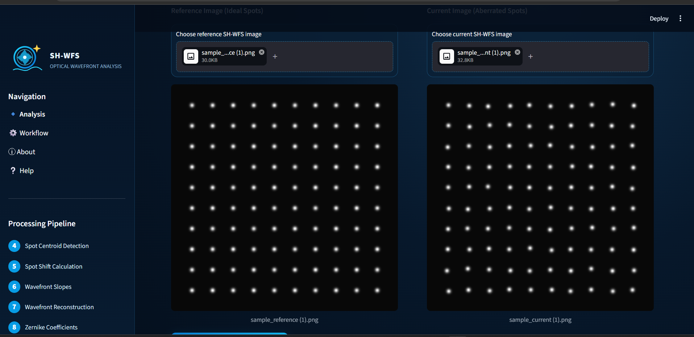
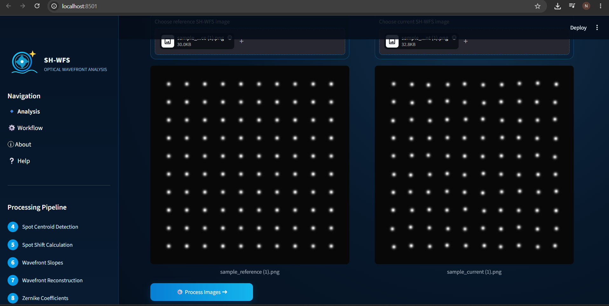
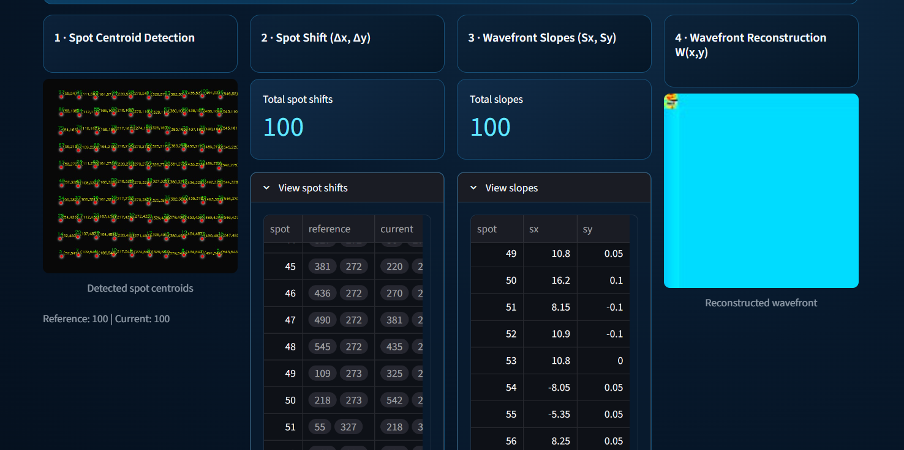
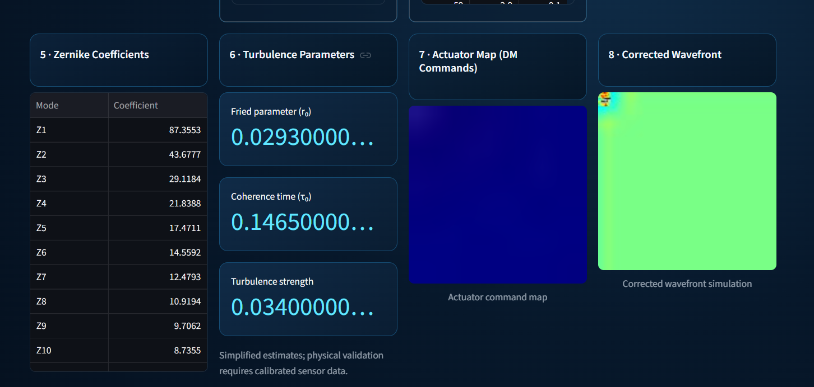

# 🔭 SH-WFS Analysis System

### Shack–Hartmann Wavefront Reconstruction & Turbulence Characterization

A Python and Streamlit-based software prototype for Shack–Hartmann Wavefront Sensor (SH-WFS) image analysis. The system processes reference and current SH-WFS images to detect spot centroids, calculate spot shifts and wavefront slopes, reconstruct wavefront visualizations, estimate turbulence parameters, and simulate deformable mirror correction.

> **Note:** This is an academic software prototype. Some reconstruction, Zernike, turbulence, and deformable mirror modules use simplified computational methods. Their outputs are not yet physically validated measurements.

---

## 🚀 Features

- Upload reference and current SH-WFS images.
- Automatic spot centroid detection.
- Spot shift calculation.
- Wavefront slope calculation.
- Wavefront reconstruction visualization.
- Zernike coefficient estimation.
- Turbulence parameter estimation.
- Actuator map generation.
- Deformable mirror correction simulation.
- Interactive Streamlit dashboard.
- Visual processing results in an organized interface.

## 🖥️ Application Screenshots

### 1. Before Processing – Image Upload

Upload reference and current SH-WFS images.



### 2. Before Processing – Ready to Analyze

Both images are uploaded and ready for processing.



### 3. After Processing – Analysis Results

Spot detection, spot shifts, wavefront slopes, and wavefront reconstruction.



### 4. After Processing – Scientific Outputs

Zernike coefficients, turbulence parameters, actuator map, and corrected wavefront simulation.



---

## 🛠️ Technologies Used

| Technology | Purpose |
|---|---|
| Python | Core programming |
| Streamlit | Web application |
| OpenCV | Image processing |
| NumPy | Numerical computation |
| Pandas | Data handling |
| Matplotlib | Visualization |
| Pillow | Image handling |
| HCIPy | Synthetic dataset generation workflow |

## 📂 Project Structure

```text
SHWFS/
├── app.py
├── main.py
├── requirements.txt
├── README.md
├── assets/
│   ├── shwfs_logo.svg
│   └── project_screenshots/
│       ├── before_processing.png
│       ├── before_process_button.png
│       ├── results_part1.png
│       └── results_part2.png
├── data/
├── dataset/
│   ├── 1.generate dataset.py
│   └── wavefront_dataset.npy
├── src/
│   ├── m2_read_frames.py
│   ├── m3_generate_spot_images.py
│   ├── m4_centroid_detection.py
│   ├── m5_spot_shift.py
│   ├── m6_slope_calculation.py
│   ├── m7_wavefront_reconstruction.py
│   ├── m8_zernike_coefficients.py
│   ├── m9_turbulence_characterization.py
│   ├── m10_actuator_map.py
│   └── m11_deformable_mirror.py
├── outputs/
└── uploads/
```

## ⚙️ Installation

**Prerequisites:** Python 3.10–3.12 recommended. Python 3.13 compatibility depends on the installed package versions.

Clone the repository:

```bash
git clone YOUR_GITHUB_REPOSITORY_URL
cd SHWFS
```

Install dependencies:

```bash
python -m pip install -r requirements.txt
```

## ▶️ Run the Application

```bash
python -m streamlit run app.py
```

Open the local URL displayed in your terminal, usually:

```text
http://localhost:8501
```

Upload a reference SH-WFS image and a current SH-WFS image, then click **Process Images** to view the analysis results.

## 🧪 Testing

The project uses synthetic SH-WFS spot images for initial software testing.

- Synthetic images are generated for testing the image-processing workflow.
- They are not real telescope or laboratory sensor captures.
- Real sensor-data validation, calibrated physical measurements, and quantitative accuracy assessment remain future work.

## 🎯 Application Domains

- Adaptive Optics
- Wavefront Sensing
- Image Processing
- Computer Vision
- Scientific Computing

## 🔮 Future Scope

- Integration with real-world SH-WFS sensor datasets.
- Improved spot-matching and wavefront reconstruction algorithms.
- Quantitative validation against ground-truth wavefront measurements.
- Improved turbulence parameter estimation.
- Advanced deformable mirror correction methods.

---

**Developed as an academic software project.**